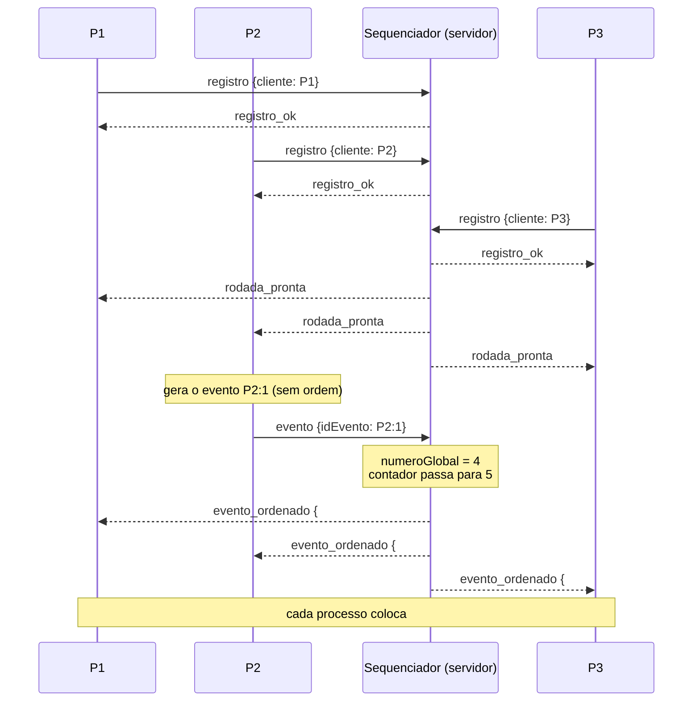
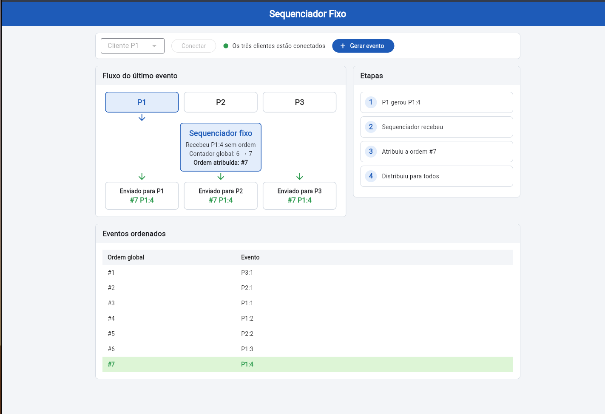
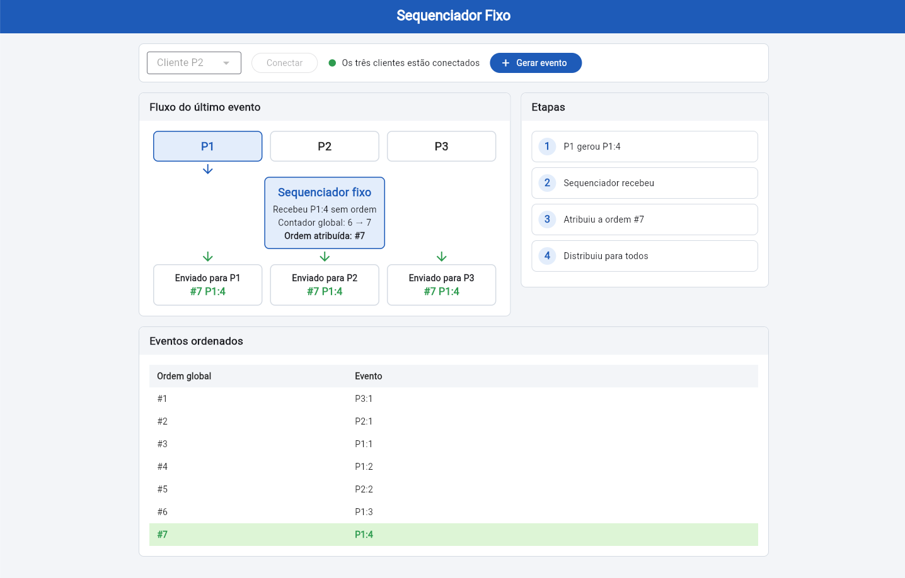
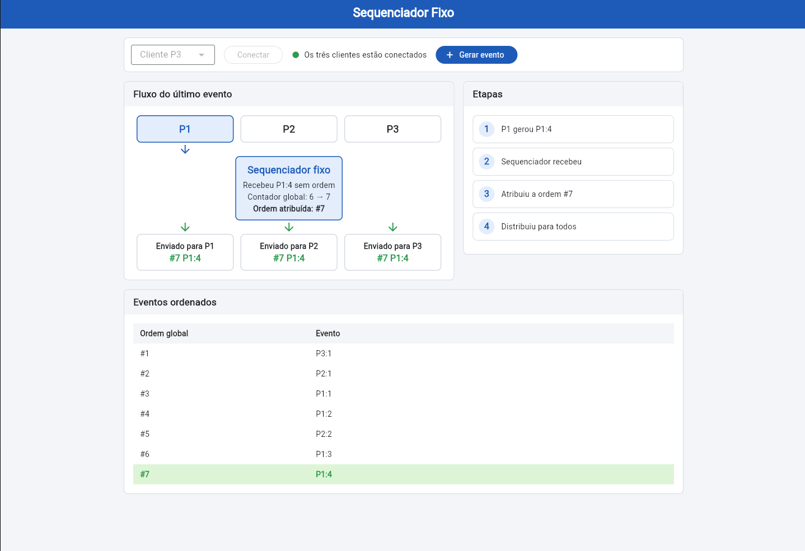

# Sequenciador fixo

Trabalho prático de Sistemas Distribuídos (UFSC Araranguá), Grupo 3: **Sequenciador fixo**.

Integrantes: Alexis Solis e Laura Soares da Silva.

## Proposta

Em um sistema distribuído, vários processos geram eventos ao mesmo tempo e cada um pode recebê-los em uma ordem diferente. O algoritmo do **sequenciador fixo** resolve isso com um processo central, sempre o mesmo, que dá um número global a cada evento. Os processos só entregam um evento depois de entregar todos os de número menor, e assim todos veem a mesma sequência (ordem total).

Implementamos o sequenciador como um **servidor em Dart** e os processos como **clientes em Flutter Web**. Cada aba do navegador é um processo (P1, P2 ou P3) e se comunica com o servidor por **WebSocket**, trocando mensagens em **JSON**.

## Requisitos funcionais

### Identificação dos processos

Os processos são identificados pelos nomes fixos `P1`, `P2` e `P3`. Ao conectar, o cliente envia uma mensagem de registro com o nome escolhido. O servidor recusa nomes fora dessa lista e nomes que já estejam conectados. A partir do registro, o servidor associa aquela conexão ao nome, e é por ela, e não pelo conteúdo das mensagens seguintes, que ele sabe quem enviou cada evento.

Cada evento também tem um identificador local criado pelo próprio cliente, no formato `processo:contador` (por exemplo `P2:1`, `P2:2`). Esse identificador diz quem gerou o evento, mas não diz nada sobre a ordem global. A ordem é dada pelo número que o sequenciador atribui (`#1`, `#2`, `#3`...).

### Cliente

O cliente permite escolher P1, P2 ou P3 e conectar ao servidor. Depois que os três processos estão conectados, ele libera o botão **Gerar evento**, que cria um novo identificador local e o envia ao sequenciador. Os eventos numerados que chegam do servidor passam por um buffer e só são mostrados na ordem global, sem pular números. A tela mostra o estado da conexão, o caminho do último evento pelo sequenciador e a lista de eventos já entregues.

### Servidor (sequenciador)

O servidor aceita conexões WebSocket no caminho `/ws`, registra os processos, avisa todos quando os três estão conectados e, para cada evento recebido, atribui o próximo número global e o envia a todos os processos conectados, inclusive a quem gerou o evento.

### Mensagens

Todas as mensagens são objetos JSON com um campo `tipo`.

| Tipo | Direção | Campos | Quando é enviada |
|---|---|---|---|
| `registro` | cliente → servidor | `cliente` | Ao conectar, para se identificar como P1, P2 ou P3 |
| `registro_ok` | servidor → cliente | `cliente` | O registro foi aceito |
| `rodada_pronta` | servidor → todos | nenhum | Os três processos estão conectados; os eventos podem começar |
| `evento` | cliente → servidor | `cliente`, `idEvento` | O usuário clicou em **Gerar evento** (ex.: `"idEvento": "P2:1"`) |
| `evento_ordenado` | servidor → todos | `numeroGlobal`, `cliente`, `idEvento` | O sequenciador numerou um evento (ex.: `#4 P2:1`) |
| `erro` | servidor → cliente | `mensagem` | Registro inválido, nome repetido, evento sem registro ou JSON inválido |

## Comunicação entre cliente e servidor

O diagrama mostra uma rodada completa: os três processos se registram, P2 gera um evento e o sequenciador o distribui com o número global.



### Envio e recebimento no cliente

A classe `Conexao` (`cliente/lib/services/conexao.dart`) abre o WebSocket, envia o registro e converte cada mensagem para JSON antes de enviar:

```dart
Future<void> conectar(String cliente) async {
  final canal = WebSocketChannel.connect(Uri.parse('ws://127.0.0.1:8080/ws'));

  await canal.ready;
  _canal = canal;

  enviar({'tipo': 'registro', 'cliente': cliente});
}

void enviar(Map<String, dynamic> dados) {
  _canal?.sink.add(jsonEncode(dados));
}
```

O evento é criado com o contador local do processo (`cliente/lib/main.dart`):

```dart
void gerarEvento() {
  final idEvento = '$clienteSelecionado:$proximoEventoLocal'; // ex.: 'P2:1'

  conexao.enviar({'tipo': 'evento', 'cliente': clienteSelecionado, 'idEvento': idEvento});

  proximoEventoLocal++;
}
```

As mensagens do servidor chegam pelo `stream` do WebSocket e são tratadas pelo `tipo`:

```dart
conexao.mensagens?.listen((mensagem) {
  final dados = jsonDecode(mensagem);

  if (dados['tipo'] == 'registro_ok') {
    // ...marca como conectado
  } else if (dados['tipo'] == 'rodada_pronta') {
    // ...libera o botão Gerar evento
  } else if (dados['tipo'] == 'erro') {
    // ...mostra a mensagem de erro
  } else if (dados['tipo'] == 'evento_ordenado') {
    // ...coloca no buffer (trecho abaixo)
  }
});
```

### Entrega ordenada com buffer

Cada cliente guarda os eventos recebidos em um mapa indexado pelo número global e só entrega o próximo número esperado. Se o `#5` chegasse antes do `#4`, ele ficaria no buffer até o `#4` chegar:

```dart
bufferEventos[numeroGlobal] = idEvento;

while (bufferEventos.containsKey(proximoNumeroEsperado)) {
  final idEventoPronto = bufferEventos.remove(proximoNumeroEsperado)!;
  eventos.add(MapEntry(proximoNumeroEsperado, idEventoPronto));
  proximoNumeroEsperado++;
}
```

## Como o serviço funciona no servidor

O servidor (`servidor/bin/servidor.dart`) usa apenas a biblioteca padrão do Dart (`dart:io` e `dart:convert`). Ele abre um `HttpServer` em `127.0.0.1:8080` e, para cada requisição, verifica se o caminho é `/ws` e se é um pedido de upgrade para WebSocket. Se não for, responde com erro 400.

O estado do sequenciador fica em três variáveis: o mapa de processos conectados, a lista de nomes permitidos e o contador global.

```dart
final clientes = <String, WebSocket>{};
final identificadoresPermitidos = {'P1', 'P2', 'P3'};

int proximoNumeroGlobal = 1;
```

No registro, o servidor valida o nome, guarda a conexão no mapa e, quando os três estão conectados, avisa todos:

```dart
if (!identificadoresPermitidos.contains(identificador)) {
  cliente.add(jsonEncode({'tipo': 'erro', 'mensagem': 'Identificador inválido'}));
  return;
}

if (clientes.containsKey(identificador)) {
  cliente.add(jsonEncode({'tipo': 'erro', 'mensagem': '$identificador já está conectado'}));
  return;
}

clientes[identificador] = cliente;
identificadorRegistrado = identificador;

cliente.add(jsonEncode({'tipo': 'registro_ok', 'cliente': identificador}));

if (clientes.length == 3) {
  final aviso = jsonEncode({'tipo': 'rodada_pronta'});
  for (final clienteConectado in clientes.values) {
    clienteConectado.add(aviso);
  }
}
```

Quando chega um evento, o servidor atribui o número global e envia o evento ordenado para todos os processos. O remetente é o nome registrado na conexão:

```dart
final numeroGlobal = proximoNumeroGlobal;
proximoNumeroGlobal++;

final eventoOrdenado = jsonEncode({
  'tipo': 'evento_ordenado',
  'numeroGlobal': numeroGlobal,
  'cliente': identificadorRegistrado,
  'idEvento': idEvento,
});

for (final clienteConectado in clientes.values) {
  clienteConectado.add(eventoOrdenado);
}
```

O Dart processa uma mensagem de cada vez no seu laço de eventos (*event loop*), então a leitura e o incremento do contador nunca são intercalados por outra mensagem. Por isso dois eventos nunca recebem o mesmo número, sem precisar de trava (*lock*).

## Instalação e execução

### Pré-requisitos

| Item | Versão | Usado por |
|---|---|---|
| Dart SDK | 3.9.2 ou mais recente | servidor (já vem junto com o Flutter) |
| Flutter com suporte a Web | compatível com Dart 3.9 | cliente |
| Google Chrome | qualquer versão recente | para abrir os clientes |

O cliente usa o pacote [`web_socket_channel`](https://pub.dev/packages/web_socket_channel) (`^3.0.3`), declarado em `cliente/pubspec.yaml` e instalado pelo `flutter pub get`. O servidor não usa pacotes externos.

No macOS, o Flutter pode ser instalado com `brew install --cask flutter`. Em outros sistemas, siga a [documentação oficial](https://docs.flutter.dev/get-started/install).

### Configuração

O endereço do servidor é fixo no código: `127.0.0.1`, porta `8080`, caminho `/ws`. Ele aparece em `servidor/bin/servidor.dart` (onde o servidor escuta) e em `cliente/lib/services/conexao.dart` (onde o cliente conecta). Para usar outra porta, altere os dois arquivos.

### Execução

Em um terminal, inicie o servidor:

```bash
cd servidor
dart pub get
dart run bin/servidor.dart
```

A saída esperada é `Servidor iniciado em ws://127.0.0.1:8080/ws`.

Em outro terminal, inicie o cliente:

```bash
cd cliente
flutter pub get
flutter run -d chrome --web-port=3000
```

Abra `http://localhost:3000` em **três abas** do Chrome. Em cada aba, escolha um processo diferente (P1, P2 e P3) e clique em **Conectar**. Quando o terceiro processo se conecta, as três abas mostram "Os três clientes estão conectados" e o botão **Gerar evento** é liberado.

## Testes

O teste foi feito com os três processos abertos em abas do Chrome, gerando eventos em processos diferentes. Em todas as abas, a tabela **Eventos ordenados** apresentou os mesmos eventos na mesma ordem global, e o servidor registrou no terminal cada número atribuído.

| P1 | P2 | P3 |
|---|---|---|
|  |  |  |

## Limitações

O tratamento de desconexões ficou fora do escopo. Se um processo desconectar e conectar de novo, ele volta a esperar o evento `#1`, enquanto o servidor já está em um número maior, e por isso não mostra nenhum evento. Para repetir a demonstração, reinicie o servidor e as três abas.

O servidor escuta apenas em `127.0.0.1`, então o servidor e os clientes precisam rodar no mesmo computador.

O buffer de cada cliente segue o algoritmo do sequenciador fixo: um evento só é entregue quando todos os números anteriores já chegaram. Como o WebSocket funciona sobre TCP e o servidor envia os eventos em ordem, na nossa demonstração eles chegam sempre em sequência e o buffer não precisa segurar nenhum evento.
